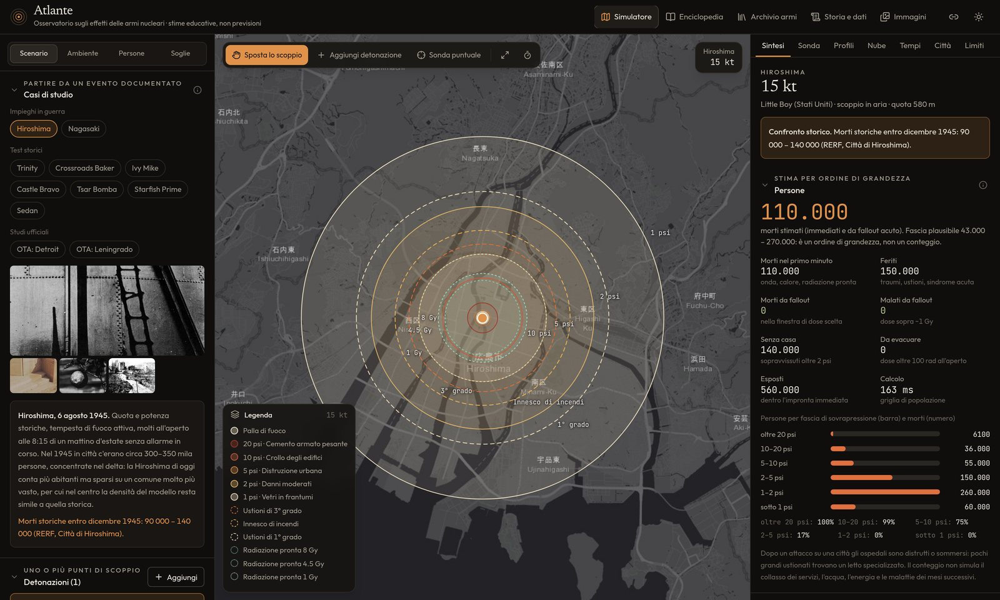
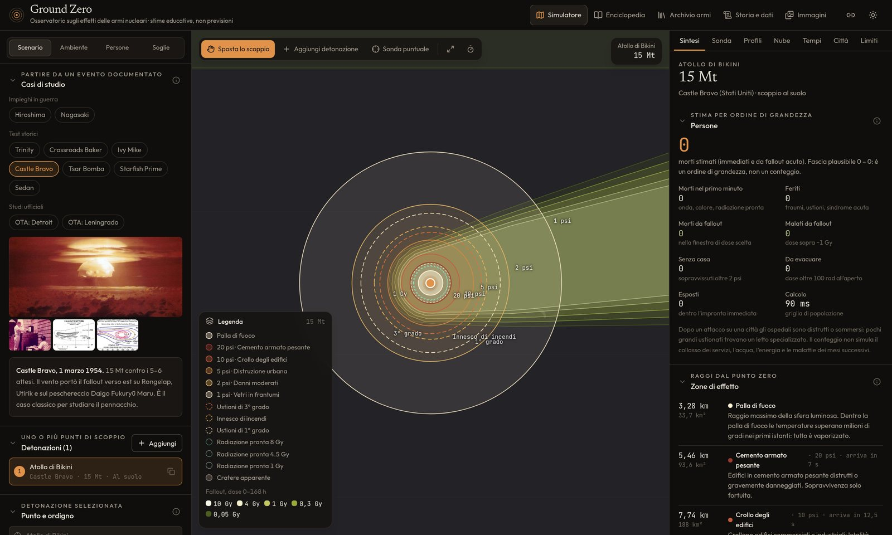
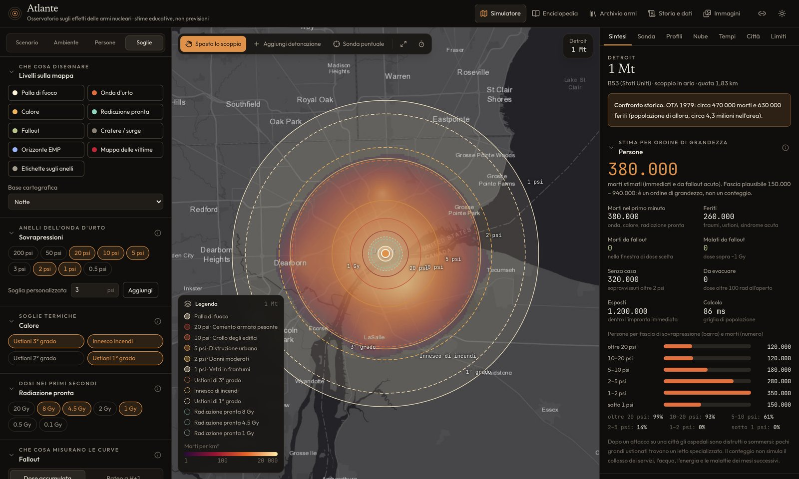
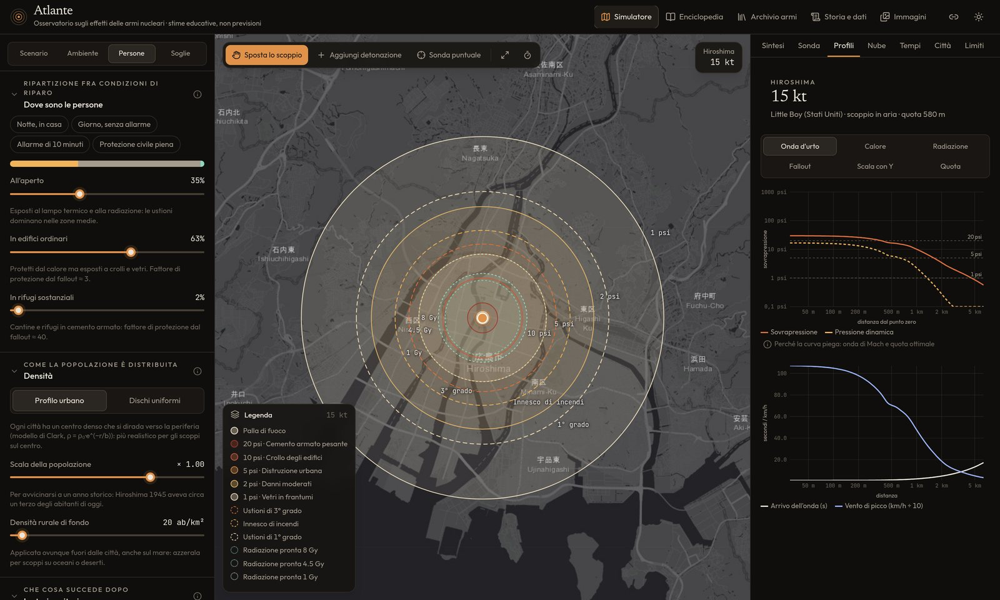
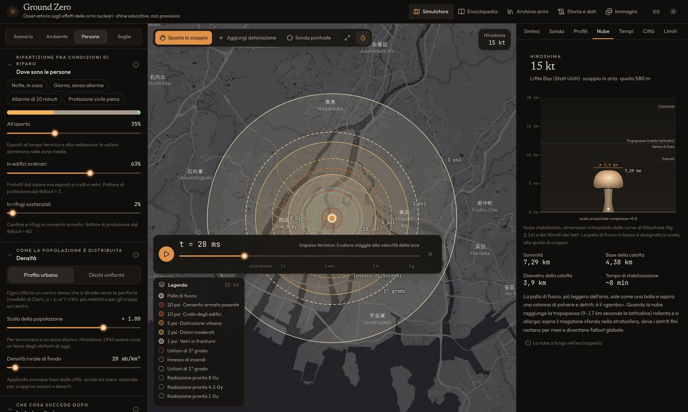
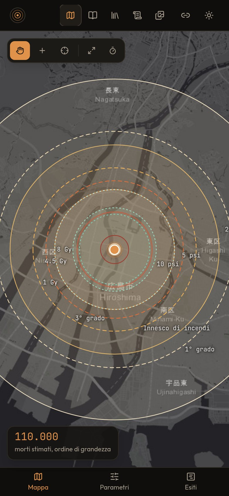
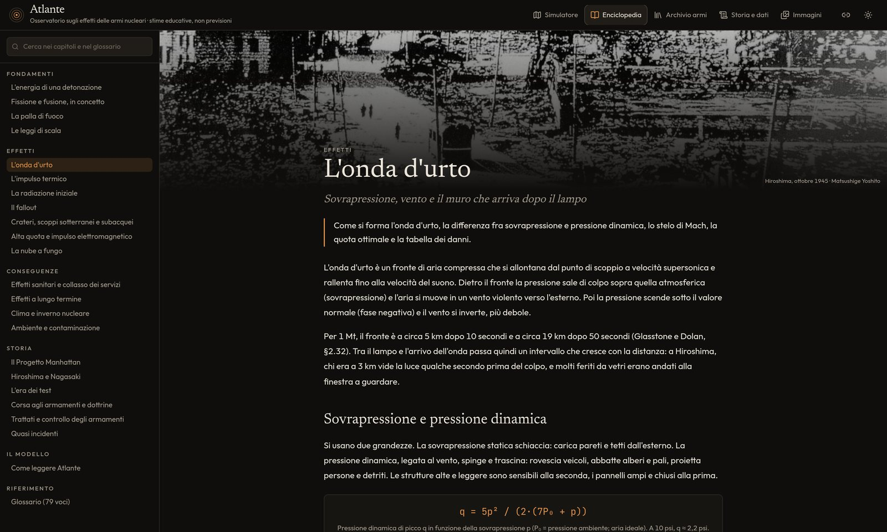
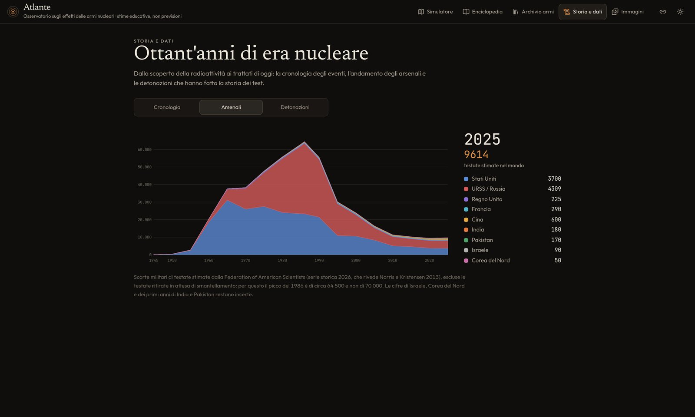
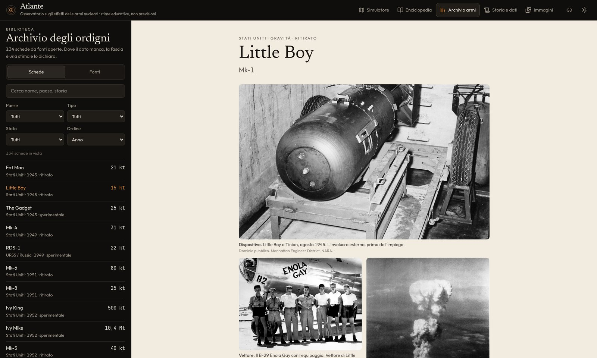
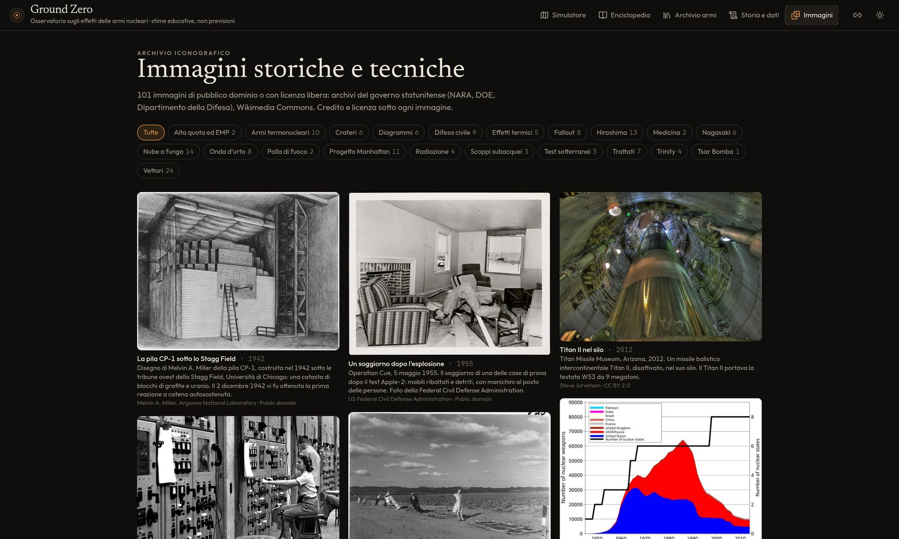

<div align="center">

# Ground Zero

**Osservatorio educativo sugli effetti delle armi nucleari**

Simulatore su mappa · Enciclopedia · Archivio storico · Dati

*Stime per ordini di grandezza, a scopo di studio. Non una previsione, non uno strumento di pianificazione.*

[](LICENSE)




</div>

---

## Indice

- [Che cos'è](#che-cosè)
- [Il simulatore](#il-simulatore)
- [Enciclopedia, storia, archivio](#enciclopedia-storia-archivio)
- [Il modello fisico](#il-modello-fisico)
- [Il modello delle conseguenze](#il-modello-delle-conseguenze)
- [Verifiche sui casi storici](#verifiche-sui-casi-storici)
- [Limiti](#limiti)
- [Avvio](#avvio)
- [Struttura del codice](#struttura-del-codice)
- [Fonti](#fonti)
- [Licenze e crediti](#licenze-e-crediti)

## Che cos'è

Ground Zero mette su una mappa gli ordini di grandezza pubblicati in mezzo secolo di letteratura aperta sugli effetti delle armi nucleari: il manuale di Glasstone e Dolan, le approssimazioni di Brode, il rapporto dell'Office of Technology Assessment del 1979, la dosimetria di Hiroshima e Nagasaki, gli studi climatici di Robock, Toon e Xia.

È pensato per lo studio: capire **perché** uno scoppio in aria e uno al suolo producono conseguenze così diverse, perché il raggio cresce solo con la radice cubica della potenza, perché il fallout dipende dal vento più che dalla bomba, perché un rifugio cambia la sopravvivenza di ordini di grandezza. Ogni pannello del simulatore rimanda al capitolo dell'enciclopedia che spiega la fisica che c'è dietro.

L'applicazione gira interamente nel browser. Le uniche chiamate in rete sono le tessere della mappa (Esri) e il meteo del punto (Open-Meteo); catalogo delle città, ordigni, testi e immagini viaggiano con la pagina.

Il progetto nasce come evoluzione di uno studio precedente realizzato con Grok, allora chiamato «Atlante», conservato intatto in [`pre_asssets/grok-workspace/`](pre_asssets/grok-workspace/).

## Il simulatore

| | |
|---|---|
|  |  |
| **Fallout di Castle Bravo**: curve di dose accumulata nella prima settimana, con il vento storico verso Rongelap. | **Studio OTA 1979, Detroit**: mappa della densità di vittime e soglie personalizzabili. |
|  |  |
| **Profili**: sovrapressione, pressione dinamica, arrivo del fronte e vento di picco in funzione della distanza. | **Cronologia animata** su scala logaritmica e **nube a fungo** in scala con quote di riferimento. |

**Scenari**
- Una o più detonazioni, ciascuna con ordigno d'archivio o potenza libera (da 1 t a 100 Mt), frazione di fissione, ritardo.
- Sei tipi di scoppio: in aria a quota ottimale (per 20, 10, 5, 2 o 1 psi), a quota libera, al suolo, sotterraneo (con profondità scalata e contenimento), subacqueo, alta quota (fino a 600 km).
- Undici casi documentati: Hiroshima, Nagasaki, Trinity, Crossroads Baker, Ivy Mike, Castle Bravo, Tsar Bomba, Starfish Prime, Sedan, studi OTA su Detroit e Leningrado. Ogni caso porta con sé note storiche, cifre di confronto e fotografie d'epoca.
- Ricerca fra 34 000 città (GeoNames), spostamento a trascinamento, scenari salvabili nel browser e condivisibili con un link.

**Ambiente**
- Meteo attuale nel punto (Open-Meteo) o valori manuali: vento con rosa dei venti, visibilità, umidità, nuvolosità, pressione, pioggia.

**Popolazione e ipotesi**
- Ripartizione fra persone all'aperto, in edifici ordinari, in rifugi sostanziali, con preimpostazioni (notte, giorno senza allarme, allarme di 10 minuti, protezione civile piena).
- Distribuzione urbana a dischi uniformi o a profilo esponenziale di Clark; scala della popolazione; densità rurale.
- Sanità funzionante o sopraffatta (dose letale mediana 4,5 o 3 Gy); tempesta di fuoco.

**Letture**
- **Sintesi**: morti immediati e da fallout con fascia d'incertezza, feriti, senza casa, da evacuare; persone e mortalità per fascia di sovrapressione e di dose; energia, palla di fuoco, cratere, nube, magnitudo sismica, area innescabile, fuliggine.
- **Sonda puntuale**: per qualunque punto, la sequenza di ciò che arriva (lampo, calore, radiazione pronta, onda d'urto con vento e durata, fallout con ora d'arrivo) e la probabilità di sopravvivenza all'aperto, in casa, in rifugio; dosi da fallout per finestre temporali e fattori di protezione.
- **Profili**: grafici interattivi per onda d'urto, calore, radiazione, fallout lungo l'asse, leggi di scala con la potenza, effetto della quota di scoppio.
- **Tempi**: la sequenza fisica dal microsecondo alla regola del 7 e 10.
- **Città** coinvolte con morti, feriti e dose da fallout; **Limiti** del modello per lo scenario corrente.

**Mappa**
- Sette basi cartografiche, anelli etichettati, curve di fallout (rateo a H+1 o dose accumulata), orizzonte EMP, mappa di calore delle vittime, cronologia animata del fronte d'urto e della ricaduta.
- Unità metriche o anglosassoni, psi o kPa, Gy o rad; tema scuro e chiaro; interfaccia utilizzabile da telefono.

<p align="center"></p>

## Enciclopedia, storia, archivio

| | |
|---|---|
|  |  |
|  |  |

- **Enciclopedia**: 22 capitoli in cinque parti (Fondamenti, Effetti, Conseguenze, Storia, Il modello), con tabelle, formule, citazioni, fonti per capitolo e figure; glossario di 79 voci; ricerca nel testo. I numeri incerti sono stati ricontrollati su fonti primarie e dove le fonti divergono il testo dà una forbice.
- **Storia e dati**: cronologia di quasi cento eventi dal 1896 (Becquerel) al 2026 (scadenza di New START); andamento degli arsenali 1945–2025 per paese (serie FAS 2026); 61 detonazioni notevoli su grafico e tabella, con la possibilità di riportarne la potenza nel simulatore.
- **Archivio**: 134 schede di ordigni da fonti aperte, con rese, grado di affidabilità del dato, vettori, dossier storici, sagome esterne di categoria e confronto con Hiroshima.
- **Immagini**: 101 fotografie e documenti di pubblico dominio o con licenza libera, filtrabili per tema, con didascalia, autore, licenza e link alla fonte.

Il materiale tratta effetti, storia, politica e medicina. **Non contiene informazioni di progetto, materiali o assemblaggio di armi**, né sezioni interne; nessuna immagine mostra feriti o vittime.

## Il modello fisico

Tutte le formule sono approssimazioni di curve pubblicate. Unità: metri, secondi, kiloton.

| Effetto | Modello | Riferimento |
|---|---|---|
| Sovrapressione | Approssimazione analitica di Brode, ±10% sulle curve di Glasstone a livello del mare; scaling di Sachs per la pressione ambiente | Brode 1986 |
| Pressione dinamica, vento, velocità del fronte | Relazioni di Rankine–Hugoniot, γ = 1,4 | Glasstone cap. 3 |
| Arrivo del fronte | Integrazione di 1/U lungo il percorso obliquo | Glasstone §2.32 |
| Palla di fuoco | R ≈ 55 m · Y^0,4 (in aria), ≈ 70 m · Y^0,4 (al suolo); picco termico t ≈ 0,0417 · Y^0,44 s | Glasstone §2.05, eq. 7.85 |
| Calore | Q = f · Y · τ / 4πR², frazione termica 18–35% secondo la geometria, trasmissione con visibilità, umidità, nubi; soglie di ustione crescenti con la durata dell'impulso | Glasstone cap. 7, fig. 12.64 |
| Radiazione pronta | Dose gamma più neutroni con attenuazione esponenziale in aria, ≈ 5 Gy a 0,72 km per 1 kt e ≈ 2,9 km per 1 Mt (distanza obliqua) | Glasstone fig. 8.33 |
| Fallout | Pennacchio gaussiano; rateo a H+1 sull'asse R₁(x) = 4,98·10⁵ · (Y_f / 1 Mt) · x^-1,44, calibrato sulle curve idealizzate per 1 Mt di fissione in vento di 15 mph; decadimento t^-1,2; dose in una finestra D = 5 · R₁ · (t_a^-0,2 − t_b^-0,2); pioggia e stabilità del vento | Glasstone §9.93 |
| Crateri e scoppi sepolti | Leggi di potenza per scoppio a contatto, profondità scalata, contenimento; base surge subacquea | Glasstone cap. 6 |
| Nube a fungo | Sommità, base e diametro interpolati in funzione della potenza | Glasstone fig. 2.16, 9.96 |
| Magnitudo sismica | mb ≈ 4,45 + 0,75 · log₁₀(Y), con accoppiamento secondo la geometria | letteratura sismologica dei test |
| EMP (alta quota) | Orizzonte in vista diretta R ≈ √(2 · Rₜ · h) | Glasstone cap. 11 |

## Il modello delle conseguenze

- **Popolazione**: città GeoNames con almeno 15 000 abitanti, rasterizzate su una griglia adattiva come dischi a densità costante o profili esponenziali, più un fondo rurale. Le voci annidate del catalogo (metropoli, distretti, quartieri) sono ricondotte a un'unica popolazione per non contare due volte le stesse persone.
- **Mortalità**: curve probit log-normali per ciascuna condizione di riparo, adattate alle fasce OTA 1979 per l'onda d'urto (oltre 12 psi circa 98% di morti; 5–12 psi circa 50%; 2–5 psi circa 5%), a Glasstone per le ustioni e alla dosimetria di Hiroshima e Nagasaki per la radiazione.
- **Più detonazioni**: rischi indipendenti combinati punto per punto (le probabilità di sopravvivenza si moltiplicano); le dosi di fallout si sommano.
- **Fallout**: calcolato nelle città punto per punto e sul fondo rurale nel sistema di riferimento di ciascun pennacchio, così che anche un pennacchio stretto non sfugga alla griglia; si applica ai sopravvissuti degli effetti immediati.
- **Fascia d'incertezza** da ×0,4 a ×2,5 attorno alla stima centrale.
- Il calcolo gira in un Web Worker e richiede in genere 100–600 ms.

## Verifiche sui casi storici

| Caso | Ground Zero | Riferimento |
|---|---|---|
| 15 kt a 580 m, raggio dei 5 psi | 1,61 km | ≈ 1,6 km (Hiroshima) |
| 1 Mt a quota ottimale, raggio dei 5 psi | 6,7 km | ≈ 7 km (Glasstone) |
| 1 Mt al suolo, raggio dei 5 psi | 4,7 km | ≈ 4,4 km (Glasstone) |
| 1 Mt, arrivo dell'onda ai 5 psi | 16 s | ≈ 15–17 s |
| Starfish Prime, orizzonte EMP | ≈ 2 300 km | Hawaii a 1 450 km colpite |
| Hiroshima, morti | ≈ 110 000 | 90 000–140 000 entro dicembre 1945 |
| OTA Detroit, 1 Mt in aria | ≈ 380 000 | ≈ 470 000 (OTA 1979) |
| OTA Leningrado, 1 Mt in aria | ≈ 1,3 milioni | ≈ 890 000 (OTA 1979) |

Le cifre delle vittime usano la popolazione odierna e servono a verificare l'ordine di grandezza, non a riprodurre un conteggio storico. Nagasaki resta sottostimata (≈ 24 000 contro 60 000–80 000): il modello concentra la popolazione nel centro odierno, a circa 3 km dal punto zero, e ignora la valle industriale di Urakami.

```bash
npm run check:physics   # ricalcola i raggi e le vittime dei casi di riferimento
```

## Limiti

- Terreno piatto: colline, edifici e strade non schermano né canalizzano onda e calore.
- Fallout con un solo vento per tutta la colonna; nessun profilo verticale, orografia o granulometria.
- Popolazione di oggi, senza differenze fra giorno e notte né pendolarismo; la densità rurale si applica anche sul mare.
- Fuori dal modello: collasso sanitario reale, incendi dei giorni successivi, inquinamento chimico, effetti su clima e produzione di cibo, conseguenze sociali e psicologiche. L'enciclopedia ne discute, il simulatore non li quantifica.

## Avvio

Richiede Node.js 20 o successivo.

```bash
git clone https://github.com/Indr1d-C0ld/Ground-Zero.git
cd Ground-Zero
npm install
npm run dev        # http://127.0.0.1:5187
```

```bash
npm run build      # typecheck e build statica in dist/
npm run preview    # serve la build
```

La build è un sito statico: può essere pubblicata su qualunque hosting di file statici.

## Struttura del codice

```
src/
├── lib/
│   ├── physics/core.ts      onda d'urto, calore, radiazione, nube, crateri, EMP
│   ├── physics/fallout.ts   pennacchio, decadimento, dosi, curve di livello
│   ├── model/effects.ts     effetti di una detonazione, anelli, sonda
│   ├── model/harm.ts        griglia di popolazione e mortalità
│   └── format.ts            unità e formattazione
├── workers/harm.worker.ts   calcolo delle vittime fuori dal thread principale
├── hooks/                   simulazione, meteo
├── state/store.ts           stato (zustand), scenari, link condivisibili
├── data/                    ordigni, dossier, città, casi, enciclopedia, galleria
└── components/
    ├── sim/                 mappa, controlli, risultati, cronologia, nube
    └── views/               enciclopedia, archivio, storia, galleria
```

## Fonti

- S. Glasstone, P. J. Dolan, *The Effects of Nuclear Weapons*, 3ª ed., US DoD / ERDA, 1977.
- H. L. Brode, *Airblast From Nuclear Bursts — Analytic Approximations*, Pacific-Sierra Research, 1986.
- Office of Technology Assessment, *The Effects of Nuclear War*, 1979.
- Radiation Effects Research Foundation, Life Span Study (Preston et al. 2007; Grant et al. 2017).
- A. Robock et al. 2007; O. B. Toon et al. 2019; L. Xia et al., *Nature Food*, 2022.
- National Academies, *Potential Environmental Effects of Nuclear War*, 2025.
- Federation of American Scientists, serie storica degli arsenali, 2026; Bulletin of the Atomic Scientists, Nuclear Notebook.
- Nuclear Weapon Archive; CTBTO; Arms Control Association; DOE/NV-209.

L'elenco completo, capitolo per capitolo, è nell'enciclopedia dell'applicazione.

## Licenze e crediti

- **Codice e testi**: © gli autori di Ground Zero, rilasciati sotto [GNU General Public License v3.0 o successiva](LICENSE).
- **Immagini** (`public/media/`): non coperte dalla GPL. Ognuna conserva la propria licenza, in gran parte pubblico dominio (opere del governo statunitense: NARA, DOE/NNSA, Dipartimento della Difesa), più alcune CC0, CC BY e CC BY-SA. Autore, licenza e fonte sono indicati in [`src/data/gallery.json`](src/data/gallery.json), [`src/data/photos.ts`](src/data/photos.ts) e sotto ogni immagine nell'applicazione.
- **Città**: [GeoNames](https://www.geonames.org/) cities15000, CC BY 4.0.
- **Meteo e quota**: [Open-Meteo](https://open-meteo.com/), CC BY 4.0.
- **Tessere cartografiche**: © Esri e fornitori; uso soggetto ai termini di servizio Esri.
- **Font**: Outfit, Newsreader, JetBrains Mono, SIL Open Font License.

## Dove gira

Pubblicato su Balthasar, il server di casa: **https://timrouter.dns.army/ground-zero/**. Per aggiornarlo:

```bash
bash deploy/pubblica.sh     # build sotto /ground-zero/, rsync, verifica della versione pubblicata
```

La prima installazione della cartella e della configurazione di Apache è in `deploy/installa-balthasar.sh` (richiede root).
